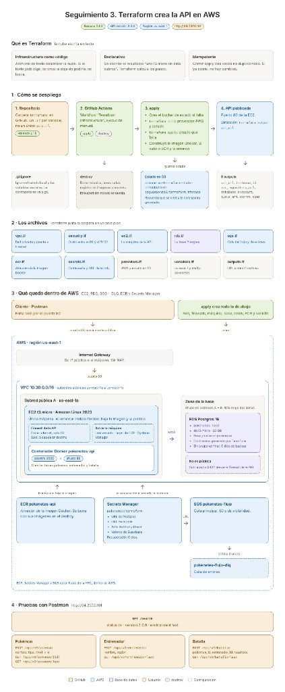
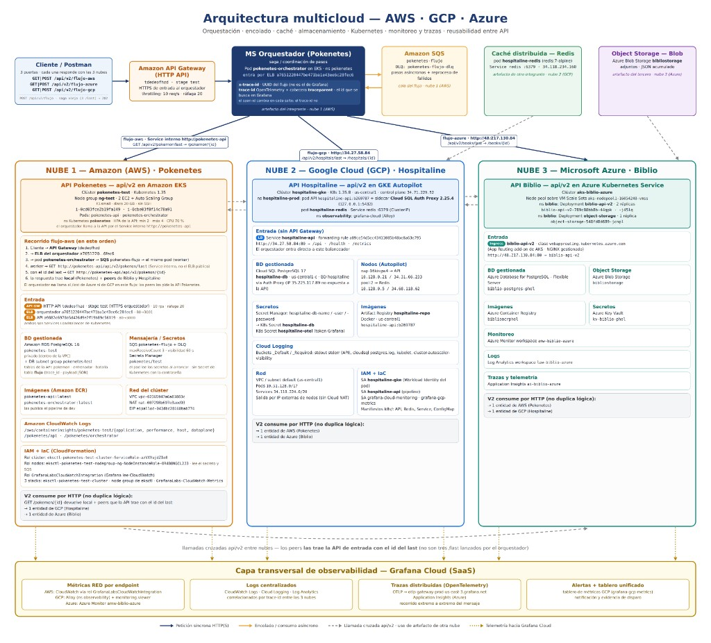
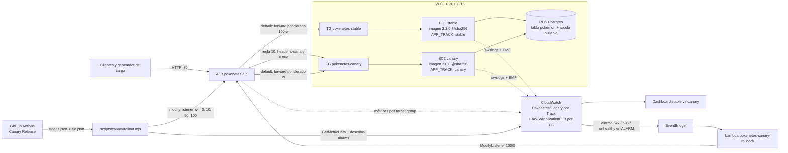

# Pokenetes

API REST en **Node.js + Fastify + TypeScript** para gestionar Pokémon, entrenadores y batallas. En AWS los datos viven en **RDS Postgres**. Versión actual: **2.0.0** (`/api/v2`).

- API: http://a9882c6970a5d426d9e2f19b89c56119-333357364.us-east-1.elb.amazonaws.com
- Orquestador: https://tdedeofhzd.execute-api.us-east-1.amazonaws.com/test

El despliegue de la entrega con Terraform está en [`terraform/README.md`](terraform/README.md). La URL pública de esa API sale de `terraform output api_url`.



## Quién opera cada nube

| Integrante | Nube | Qué opera |
|---|---|---|
| Neithan (Enedev) | AWS | API Pokenetes en EKS, orquestador, SQS + DLQ, API Gateway, Secrets Manager, RDS Postgres, CloudWatch |
| Phol (PholCast) | Azure | API biblio-express. Pokenetes consume `books` |
| Dhani (Dhani-dev) | GCP | API Hospitaline. Pokenetes consume `hospitals` |

El tablero compartido es Grafana Cloud.

## Arquitectura

Neithan opera AWS. Phol opera Azure y Dhani opera GCP.



---

## Canary deployment (Seguimiento #3, entrega 4)

La versión estable **2.2.0** (`api/v2`) y la versión canary **3.0.0** (`api/v3`) corren al mismo tiempo en AWS detrás de un Application Load Balancer. El balanceador manda al canary un porcentaje controlado del tráfico público, y las alarmas sobre los SLO lo regresan a 0% si algo se degrada.



| Pieza | Qué hace | Dónde |
|---|---|---|
| Proveedor | AWS (us-east-1), todo con Terraform | [`terraform/`](terraform/) |
| Enrutamiento | Listener HTTP del ALB con `forward` ponderado entre dos target groups, más una regla que manda `x-canary: true` siempre al canary | [`terraform/alb.tf`](terraform/alb.tf) |
| Artefacto inmutable | Cada instancia corre la imagen de ECR fijada por digest (`repo@sha256:...`). Terraform rechaza una imagen sin digest | [`terraform/variables.tf`](terraform/variables.tf), [`terraform/ec2.tf`](terraform/ec2.tf) |
| Automatización | `Terraform Infrastructure` construye `2.2.0` y `3.0.0` desde sus tags y despliega por digest. `Canary Release` recorre las etapas | [`.github/workflows/`](.github/workflows/) |
| Umbrales versionados | SLO y etapas en JSON. Terraform y los scripts leen los mismos archivos | [`canary/slo.json`](canary/slo.json), [`canary/stages.json`](canary/stages.json) |
| Rollback automático | Alarmas de CloudWatch, regla de EventBridge y Lambda que vuelve a 100/0 | [`terraform/cloudwatch.tf`](terraform/cloudwatch.tf), [`terraform/rollback.tf`](terraform/rollback.tf) |

Cada respuesta dice qué la atendió con las cabeceras `X-App-Version` (`2.2.0` o `3.0.0`), `X-App-Track` (`stable` o `canary`) y `X-Api-Version` (`v1`, `v2` o `v3`). `/health` devuelve además `app_version` y `track` en el cuerpo.

### Etapas y bake times

Definidas en [`canary/stages.json`](canary/stages.json). En cada etapa el script mueve el peso, mete carga concurrente durante todo el bake time y al final decide si promover, pausar o abortar.

| Etapa | Tráfico público al canary | Bake time | Cómo entra el tráfico al canary | Pasa a la siguiente si |
|---|---|---|---|---|
| Stage 0 | 0% | 90 s | Solo con `x-canary: true`. La carga manda la cabecera en la mitad de las peticiones para tener baseline y canary del mismo tamaño | SLO en verde y al menos 300 muestras del canary |
| Stage 1 | 10% | 180 s | Peso 90/10 en el listener | Igual, más ninguna alarma en `ALARM` |
| Stage 2 | 50% | 180 s | Peso 50/50 | Igual |
| Stage 3 | 100% | 120 s | Peso 0/100. Versión promovida | Igual. Al terminar, 3.0.0 atiende todo |

La mezcla de carga es la misma para los dos tracks: `GET /api/pokemon/last`, `GET /api/entrenador/last`, `GET /api/batalla/last`, `GET /api/pokemon` y `POST /api/pokemon` con `apodo`. Así se comparan peticiones equivalentes, en la misma ventana de tiempo y en instancias del mismo tipo (`t3.micro`).

### SLO y quality gate

Los umbrales están en [`canary/slo.json`](canary/slo.json). Las alarmas de Terraform y el script de rollout leen ese mismo archivo, así que cambiar un umbral es un commit.

| SLI | Promover si ≤ | Pausar si ≤ | Abortar si > |
|---|---|---|---|
| Tasa de 5xx del canary | 1% | 2% | 5% |
| Latencia p95 | 500 ms | 800 ms | 1000 ms |
| Latencia p99 | 1000 ms | 1500 ms | 2000 ms |
| p95 canary / p95 baseline | 1.25 | 1.5 | 2 |

- **Pausar** repite el bake time a la mitad. Si sigue en pausa, el canary se queda en el peso actual y el job termina con código 2 para que alguien decida.
- **Abortar** pone el peso del canary en 0, apaga la falla inyectada y deja el reporte en `canary/reports/` (artefacto del job).
- **Comparación contra el baseline**: una prueba z de dos proporciones sobre la tasa de 5xx de canary contra stable en la misma ventana. Si la diferencia es significativa (α = 0.05) y el canary pasa el 1%, se aborta aunque no haya llegado al 5%.
- **Tamaño de muestra**: para distinguir 1% de 5% de errores con α = 0.05 y potencia 0.8 hacen falta unas 284 peticiones por track. El gate pide 300 (`min_samples_per_track`); con menos, la decisión es pausar, nunca promover.
- **Fuera del script**, CloudWatch evalúa cada minuto tres alarmas sobre el target group del canary: 5xx por encima de 5% con al menos 20 peticiones, p95 por encima de 1 s durante 2 minutos, y el target unhealthy. Cualquiera en `ALARM` dispara la Lambda de rollback, aunque nadie esté corriendo el script.

### Métricas por track

| Señal | Métrica | Fuente |
|---|---|---|
| Tráfico | `RequestCount`, `Requests` | ALB por target group, EMF por `Track` |
| Errores | `HTTPCode_Target_5XX_Count`, `HTTPCode_Target_4XX_Count`, `Errors5xx`, `Errors4xx` | ALB, EMF |
| Latencia | `TargetResponseTime` p50 / p95 / p99, `Latency` | ALB, EMF |
| Saturación | `CPUUtilization` de la instancia, `ProcessCpu`, `MemoryRss`, `HeapUsed` | EC2, EMF cada 30 s |
| Negocio | `PokemonCreated` (POST de pokemon con 201) | EMF |

La app escribe las métricas EMF como líneas JSON en stdout (`METRICS_EMF=true`). El driver `awslogs` de Docker las manda a `/pokenetes/canary`, y CloudWatch las convierte en métricas del namespace `Pokenetes/Canary` con la dimensión `Track`. El dashboard `pokenetes-canary` (`terraform output dashboard_url`) pone cada señal con stable en azul y canary en naranja, junto a las alarmas.

---

## Entornos y ramas

| Rama | Entorno | Coverage mínimo |
|---|---|---|
| `dev` | Test / staging | ≥ 50% |
| `main` | Producción | ≥ 50% |

Flujo: trabajas en `dev` → el pipeline de test valida el código → cuando está estable, mergeas `dev` en `main` → el pipeline de prod valida de nuevo.

Los umbrales de cobertura se cambian en un solo archivo: [`coverage-gates.json`](./coverage-gates.json) (`test` = 50, `prod` = 50).

---

## Requisitos locales

- Node.js 22+
- npm
- [Docker Desktop](https://www.docker.com/products/docker-desktop/) (solo para correr con contenedores)
- Archivos `.env.test` y/o `.env.prod` (copia desde los `.example`)

```bash
cp .env.test.example .env.test
cp .env.prod.example .env.prod
```

Variables necesarias:

```
PORT=3000
NODE_ENV=test
SUPABASE_URL=...
SUPABASE_PUBLISHABLE_KEY=...
SUPABASE_SECRET_KEY=...
SUPABASE_JWKS_URL=...
DATABASE_URL=...   # opcional; si existe, crea las tablas al arrancar
```

---

## Cómo correr el proyecto

```bash
npm install
npm run dev                 # desarrollo con recarga
npm run build               # compila TypeScript a dist/
npm start                   # arranca dist/index.js
npm test                    # corre la suite de tests
npm run test:coverage       # coverage con umbral de test (≥ 50%)
npm run test:coverage:prod  # coverage con umbral de producción (≥ 50%)
```

---

## Coverage

Los dos entornos usan **la misma suite de tests**. Lo que cambia es el **mínimo exigido**:

| Entorno | Comando | Umbral | Archivo de config |
|---|---|---|---|
| Test (`dev`) | `npm run test:coverage` | ≥ 50% | `vitest.config.pruebas.ts` |
| Producción (`main`) | `npm run test:coverage:prod` | ≥ 50% | `vitest.config.prod.ts` |

Los umbrales se editan en [`coverage-gates.json`](./coverage-gates.json). Si la cobertura queda por debajo del umbral, el comando falla (en local y en CI).

Generar el reporte e abrirlo:

```bash
npm run test:coverage
# o: npm run test:coverage:prod

# Windows
start coverage/index.html

# macOS
open coverage/index.html

# Linux
xdg-open coverage/index.html
```

El porcentaje también aparece en la terminal (`All files`). El HTML se escribe en `coverage/index.html` (esa carpeta está en `.gitignore`).

---

## Docker

La API y una base Postgres local se levantan juntas con Compose.

| Archivo | Rol |
|---|---|
| `Dockerfile` | Imagen de la API (compila TypeScript y ejecuta `node dist/index.js`) |
| `docker-compose.yml` | Servicio `api` + servicio `db` (Postgres 16) |
| `docker/init.sql` | Crea las tablas `pokemon`, `entrenador` y `batalla` al iniciar Postgres |

Necesitas Docker Desktop en ejecución y un archivo `.env.test` en la raíz (Supabase).

```bash
docker compose up --build
# equivalente: npm run docker:up
```

| Contenedor | Servicio | Puerto |
|---|---|---|
| `pokenetes-api` | Fastify | `3000` |
| `pokenetes-db` | Postgres 16 | `5432` |

Compose inyecta `DATABASE_URL` hacia el servicio `db`. Las operaciones REST usan las credenciales de Supabase de `.env.test`.

```bash
curl http://localhost:3000/health
curl http://localhost:3000/
docker compose ps
docker logs pokenetes-api
```

Detener:

```bash
docker compose down
# equivalente: npm run docker:down
```

`docker compose down -v` elimina también el volumen `pgdata` de Postgres.

En CI, después de tests y coverage, el pipeline construye la misma imagen con `docker build`.

---

## Endpoints

Cada entidad expone todos estos verbos: `GET`, `POST`, `PUT`, `PATCH`, `DELETE`, `HEAD`, `QUERY`.

| Método | Ruta | Descripción |
|---|---|---|
| `GET` | `/` | Índice de la API |
| `GET` | `/health` | Health check |
| `GET` | `/pokemon` `/entrenador` `/batalla` | Listar |
| `GET` | `/pokemon/:id` (igual para las otras) | Obtener uno |
| `POST` | `/pokemon` `/entrenador` `/batalla` | Crear |
| `PUT` | `/pokemon/:id` | Reemplazo completo |
| `PATCH` | `/pokemon/:id` | Actualización parcial |
| `DELETE` | `/pokemon/:id` | Eliminar |
| `HEAD` | `/pokemon` y `/pokemon/:id` | Igual que GET, sin body |
| `QUERY` | `/pokemon` `/entrenador` `/batalla` | Consulta RFC 9324 |
| `QUERY` | `/query` | Consulta genérica (`entity` + `limit`) |

`HEAD` lo genera Fastify a partir de cada `GET`.

Las mismas rutas de negocio existen bajo `/api/v2` (listar, crear, actualizar, borrar). El GET all de v2 **no** mezcla APIs ajenas. El GET by id de v2 **sí** pide el last de las otras nubes.

### GET /api/v2/{entidad}/last

Solo el **último registro local**. Sin `peers`.

```bash
curl http://localhost:3000/api/v2/pokemon/last
```

### GET /api/v2/{entidad}/:id

Uno local (ese id) + last en vivo de biblio-express y Hospitaline. Así salen los 3 objetos.

```bash
curl http://localhost:3000/api/v2/pokemon/UUID
```

```json
{
  "api": "pokenetes",
  "version": "2.0.0",
  "trace_id": "...",
  "entity": "pokemon",
  "local": { "id": "...", "nombre": "Pikachu" },
  "peers": {
    "biblio-express": { "live": true, "entity": "books", "data": { "title": "..." } },
    "hospitaline": { "live": true, "entity": "hospitals", "data": { "name": "..." } }
  }
}
```

APIs compañeras:

- [biblio-express](https://github.com/PholCast/biblio-express) — users, books, loans. Se consume `books` en **Azure**.
- [Hospitaline](https://github.com/Dhani-dev/Hospitaline) — hospitals, doctors, pacientes. Se consume `hospitals` en **GCP**.

Hasta que esas URLs existan, deja `BIBLIO_API_URL` y `HOSPITALINE_API_URL` vacías.

El tag `v1.0.0` marca Seguimiento #1. El tag `v2.0.0` se crea al terminar Seguimiento #2.

## Orquestador

Microservicio en `orchestrator/`. Arranca el saga `POST /api/v2/flujo` (puerto 3001). Guía: [`orchestrator/README.md`](./orchestrator/README.md).

El GET by id de v2 intenta `.../last` del compañero; si aún no existe, usa su listado y toma el último ítem. Configura `BIBLIO_API_URL` y `HOSPITALINE_API_URL` en `.env` o en Secrets Manager. Si un peer falla, `local` sigue saliendo y el peer marca `live: false` (nunca se inventan datos).

### Ejemplos

```bash
curl http://localhost:3000/health

curl -X POST http://localhost:3000/pokemon \
  -H "Content-Type: application/json" \
  -d '{"nombre":"Pikachu","tipo":"Electrico","nivel":5}'

curl http://localhost:3000/pokemon
curl http://localhost:3000/pokemon/UUID

curl -X PUT http://localhost:3000/pokemon/UUID \
  -H "Content-Type: application/json" \
  -d '{"nombre":"Pikachu","tipo":"Electrico","nivel":10}'

curl -X PATCH http://localhost:3000/pokemon/UUID \
  -H "Content-Type: application/json" \
  -d '{"nivel":8}'

curl -X DELETE http://localhost:3000/pokemon/UUID
curl -I http://localhost:3000/pokemon

curl -X QUERY http://localhost:3000/pokemon \
  -H "Content-Type: application/json" \
  -d '{"limit":5}'
```

Cuerpos de las otras entidades:

```json
{ "nombre": "Ash", "region": "Kanto" }
```

```json
{ "pokemon_id": "UUID-POKEMON", "entrenador_id": "UUID-ENTRENADOR", "resultado": "victoria" }
```

---

## Base de datos

Tablas permitidas: `pokemon`, `entrenador`, `batalla`.

Si las tablas no existen, el arranque falla. Créalas en el SQL Editor de cada proyecto Supabase (test y prod). El DDL está en `src/db/schemas/`.

Si configuras `DATABASE_URL`, la app aplica el DDL sola al iniciar.

---

## GitHub Actions (CI/CD)

Hay **tres pipelines**. No se ejecutan en tu PC: corren en los servidores de GitHub.

| Archivo | Nombre en GitHub | Se dispara cuando | Coverage |
|---|---|---|---|
| `.github/workflows/test-pipeline.yml` | **Test Environment Pipeline** | Push o PR a `dev`, o corrida manual | ≥ 50% |
| `.github/workflows/prod-pipeline.yml` | **Production Environment Pipeline** | Push a `main`, o corrida manual | ≥ 50% |
| `.github/workflows/terraform-pipeline.yml` | **Terraform Infrastructure** | Solo manual. `apply` crea la nube e instala la API. `destroy` la borra. | no aplica |

Cada corrida hace: instalar → build → tests → coverage.

### Cómo se ejecutan solos (lo normal)

1. `git push origin dev` → pipeline de **test**.
2. `git push origin main` (o merge `dev` → `main`) → pipeline de **prod**.
3. Un Pull Request hacia `dev` → pipeline de test (solo valida).

No tienes que pulsar nada: GitHub detecta el push y lanza el workflow.

### Cómo ver si pasó o falló

1. Entra al repo: https://github.com/Enedev/Pokenetes-API
2. Pestaña **Actions**.
3. A la izquierda ves los tres workflows.
4. Al centro, el historial (verde = OK, rojo = falló, amarillo = en curso).
5. Entra a una corrida para ver cada paso.

También aparece un check al lado de cada commit.

### Cómo ejecutarlo manualmente

Sirve para revalidar **sin un commit nuevo**.

1. Repo → **Actions**.
2. Elige el workflow:
   - `Test Environment Pipeline` (test)
   - `Production Environment Pipeline` (prod)
   - `Terraform Infrastructure` (`apply` o `destroy`)
3. Arriba a la derecha: **Run workflow**.
4. Rama: `dev` para test, `main` para prod.
5. Pulsa **Run workflow**.

### Desde la terminal

Con [GitHub CLI](https://cli.github.com/):

```bash
gh workflow run "Test Environment Pipeline" --ref dev
gh workflow run "Production Environment Pipeline" --ref main
```

Ver corridas:

```bash
gh run list
gh run watch
```

---

## Estructura

```
src/
  index.ts              Entrada del servidor
  app.ts                Fastify + rutas
  config/env.ts         Carga .env.test o .env.prod
  db/client.ts          Cliente Supabase
  db/migrate.ts         Migraciones / verificación de tablas
  db/schemas/           DDL de pokemon, entrenador, batalla
  routes/               REST de las 3 entidades + last v2
  integrations/         Cliente HTTP de APIs compañeras
tests/                  Vitest
docker/init.sql         Tablas para Postgres local
Dockerfile              Imagen de la API
docker-compose.yml      API + Postgres
coverage-gates.json     Umbrales 60 (test) / 85 (prod)
.github/workflows/      CI/CD, incluido Terraform Infrastructure
terraform/              Un archivo por servicio de AWS y el README de despliegue
```
