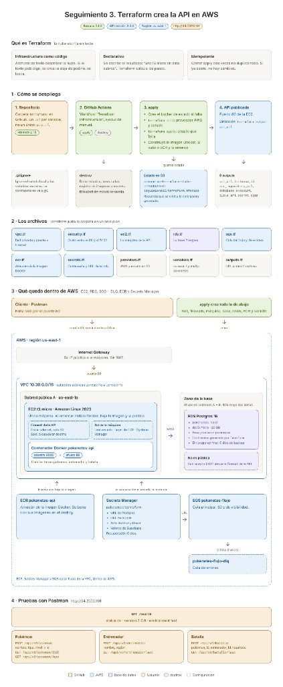

# Despliegue con Terraform



Estos archivos crean la infraestructura de AWS para el canary: un ALB, dos instancias (stable y canary) fijadas por digest, RDS, alarmas y la Lambda de rollback. Cada servicio está en su propio archivo:

| Archivo | Servicio |
|---|---|
| `vpc.tf` | VPC, subredes e internet gateway |
| `security.tf` | Security groups del ALB, de la API y de Postgres |
| `ec2.tf` | Una instancia por track, rol e IAM |
| `alb.tf` | Application Load Balancer, target groups y la regla `x-canary` |
| `rds.tf` | Base de datos PostgreSQL |
| `sqs.tf` | Cola del flujo y su DLQ |
| `ecr.tf` | Repositorio de la imagen |
| `secrets.tf` | Secreto con la URL de la base, la cola y el token de fallas |
| `cloudwatch.tf` | Alarmas de aborto leídas de `canary/slo.json` |
| `dashboard.tf` | Tablero stable vs canary |
| `rollback.tf` | Lambda que vuelve el tráfico a 100/0 |
| `providers.tf` | Proveedor AWS y el estado remoto en S3 |
| `variables.tf` | Región, digests, stickiness y rollback |
| `outputs.tf` | URL del ALB, dashboard, target groups y repositorio |

No hay un único `main.tf`. El estado queda en el bucket `pokenetes-terraform-state-722500516562`, no en git.

## Crear la infraestructura

Hace falta Terraform 1.5 o superior y credenciales de AWS en la cuenta `722500516562`.

```bash
aws s3 mb s3://pokenetes-terraform-state-722500516562 --region us-east-1
cd terraform
terraform init
terraform apply
```

`terraform apply` pide las imágenes `stable_image` y `canary_image` por digest (`repo@sha256:...`). Crea la red, el ALB, las dos instancias, RDS, SQS, ECR, el secreto, las alarmas, el dashboard y la Lambda. Arranca en Stage 0: 100% stable y 0% canary, con `x-canary: true` yendo siempre al canary. La URL queda en `terraform output api_url`.

## Instalar las dos versiones

En GitHub: Actions → **Terraform Infrastructure** → **Run workflow** → action `apply`, con `stable_ref=2.2.0` y `canary_ref=3.0.0`.

Ese workflow construye las dos imágenes desde sus tags, las sube a ECR, las fija por digest y espera a que los dos targets estén healthy. Después, Actions → **Canary Release** recorre las etapas de `canary/stages.json`.

## Eliminar la infraestructura

Después de la sustentación hay que apagar el costo. Desde esta carpeta:

```bash
terraform destroy
```

O en GitHub Actions, el mismo workflow con action `destroy`.

`destroy` borra el ALB, las dos instancias, la base, las colas, el repositorio, el secreto, las alarmas, el dashboard y la Lambda. El bucket del estado no se borra solo. Cuando el destroy termine y ya no haga falta repetirlo:

```bash
aws s3 rb s3://pokenetes-terraform-state-722500516562 --force
```

RDS se crea con `skip_final_snapshot`, así que destroy no deja un snapshot cobrando.
